

<a href="https://mateusz-dams.github.io/"><picture><source media="(prefers-color-scheme: dark)" srcset="img/baner-ciemny.webp">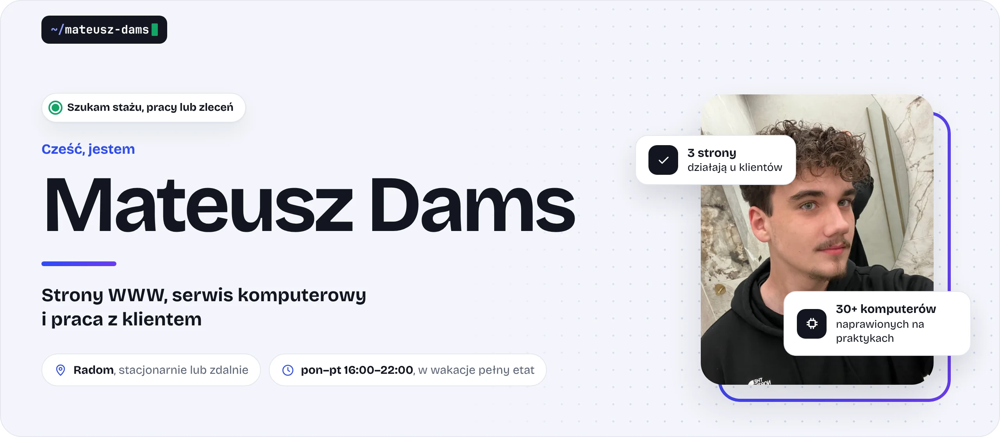</picture></a>

<a href="https://mateusz-dams.github.io/"><picture><source media="(prefers-color-scheme: dark)" srcset="img/przycisk-portfolio-ciemny.png"></picture></a>
<a href="https://mateusz-dams.github.io/cv/CV-Mateusz-Dams.pdf"><picture><source media="(prefers-color-scheme: dark)" srcset="img/przycisk-cv-ciemny.png">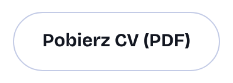</picture></a>
<a href="mailto:dams.mateusz@gmail.com"><picture><source media="(prefers-color-scheme: dark)" srcset="img/przycisk-mail-ciemny.png"></picture></a>

tel. 505 309 362 · Radom, stacjonarnie lub zdalnie

 

<picture><source media="(prefers-color-scheme: dark)" srcset="img/naglowek-o-mnie-ciemny.png"></picture>

<a href="https://mateusz-dams.github.io/#o-mnie"><picture><source media="(prefers-color-scheme: dark)" srcset="img/o-mnie-ciemny.webp">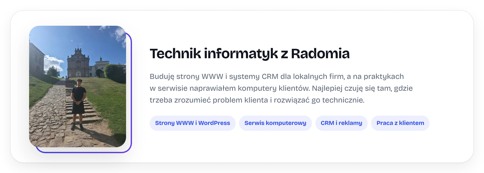</picture></a>

 

<picture><source media="(prefers-color-scheme: dark)" srcset="img/naglowek-doswiadczenie-ciemny.png"></picture>

<a href="https://mateusz-dams.github.io/#doswiadczenie"><picture><source media="(prefers-color-scheme: dark)" srcset="img/doswiadczenie-ciemny.webp">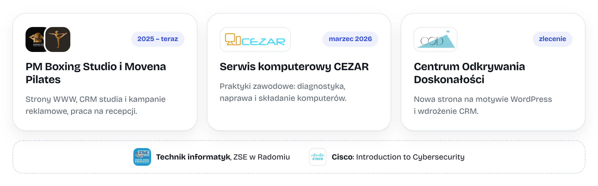</picture></a>

 

<picture><source media="(prefers-color-scheme: dark)" srcset="img/naglowek-projekty-ciemny.png"></picture>

<a href="https://mateusz-dams.github.io/projekty/pm-boxing.html"><picture><source media="(prefers-color-scheme: dark)" srcset="img/projekt-pm-boxing-ciemny.webp">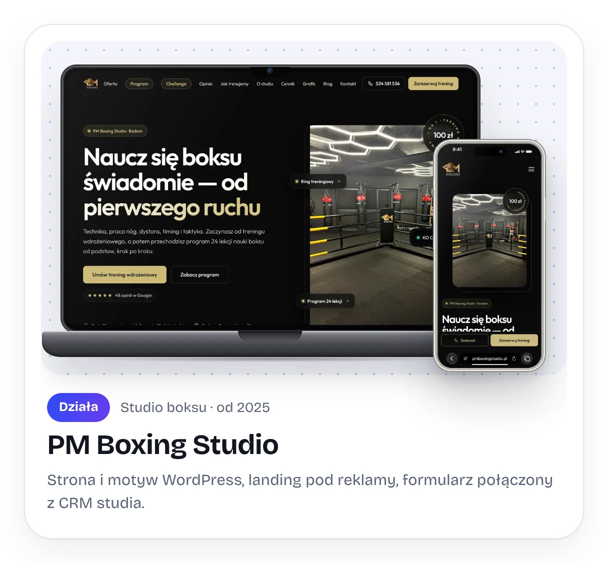</picture></a>
<a href="https://mateusz-dams.github.io/projekty/movena.html"><picture><source media="(prefers-color-scheme: dark)" srcset="img/projekt-movena-ciemny.webp">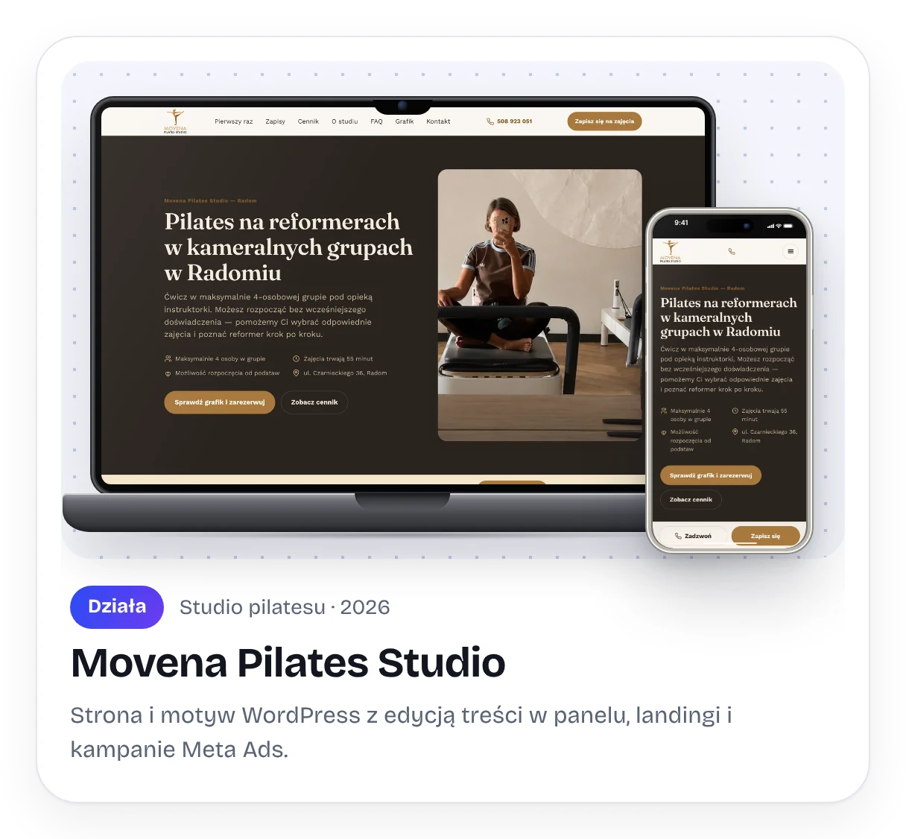</picture></a>
<a href="https://mateusz-dams.github.io/projekty/cod.html"><picture><source media="(prefers-color-scheme: dark)" srcset="img/projekt-cod-ciemny.webp">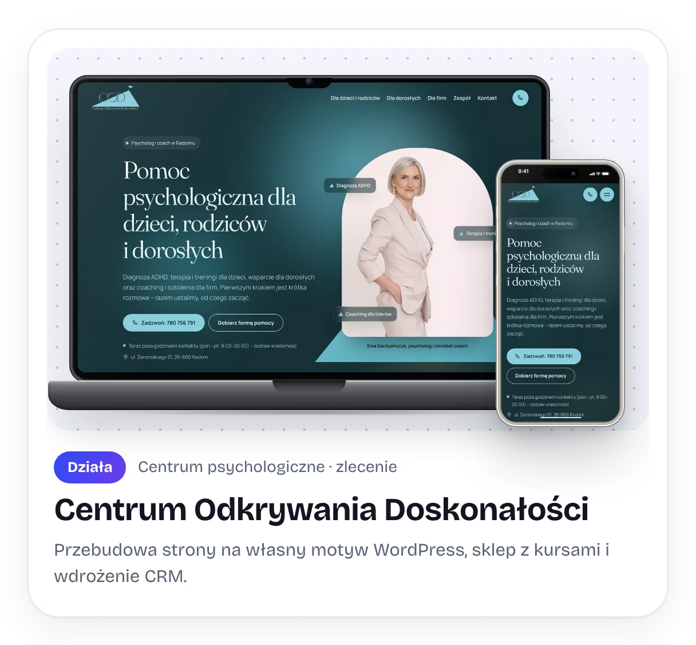</picture></a>
<a href="https://mateusz-dams.github.io/projekty/bizzlife.html"><picture><source media="(prefers-color-scheme: dark)" srcset="img/projekt-bizzlife-ciemny.webp">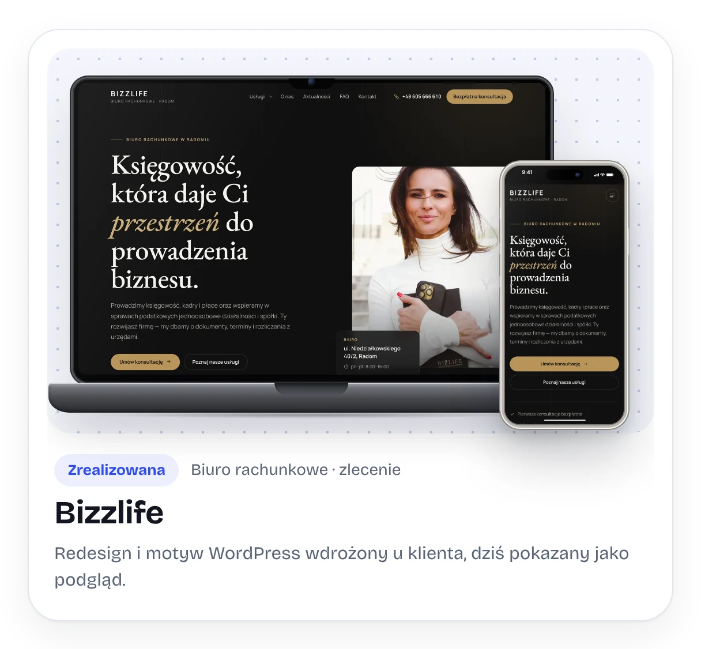</picture></a>

Każdy projekt ma w swoim folderze opis „Mój udział” (cel, mój zakres, sposób sprawdzenia przed publikacją i efekt), statyczną kopię strony, zrzuty ekranu i wybrane fragmenty kodu motywu: [PM Boxing Studio](https://github.com/mateusz-dams/mateusz-dams.github.io/tree/main/pm-boxing) · [Movena Pilates Studio](https://github.com/mateusz-dams/mateusz-dams.github.io/tree/main/movena) · [Centrum Odkrywania Doskonałości](https://github.com/mateusz-dams/mateusz-dams.github.io/tree/main/cod) · [Bizzlife](https://github.com/mateusz-dams/mateusz-dams.github.io/tree/main/bizzlife). Pełne motywy nie są publikowane, a kod nie zawiera kluczy, tokenów, adresów CRM ani identyfikatorów pomiaru.

 

<picture><source media="(prefers-color-scheme: dark)" srcset="img/naglowek-cwiczenia-ciemny.png"></picture>

<a href="https://mateusz-dams.github.io/cwiczenia/topblind.html"><picture><source media="(prefers-color-scheme: dark)" srcset="img/cwiczenie-topblind-ciemny.webp">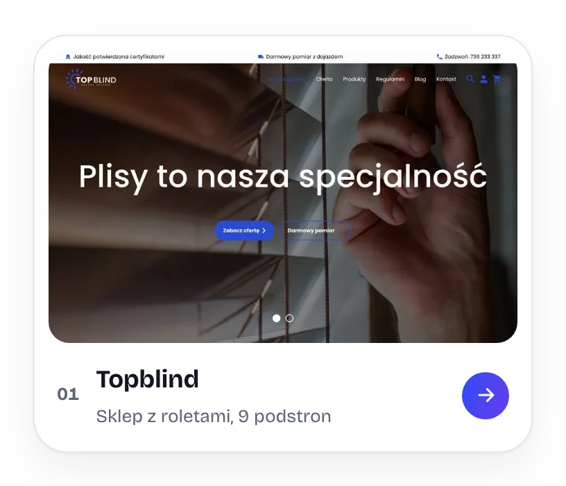</picture></a>
<a href="https://mateusz-dams.github.io/cwiczenia/austrowaren.html"><picture><source media="(prefers-color-scheme: dark)" srcset="img/cwiczenie-austrowaren-ciemny.webp">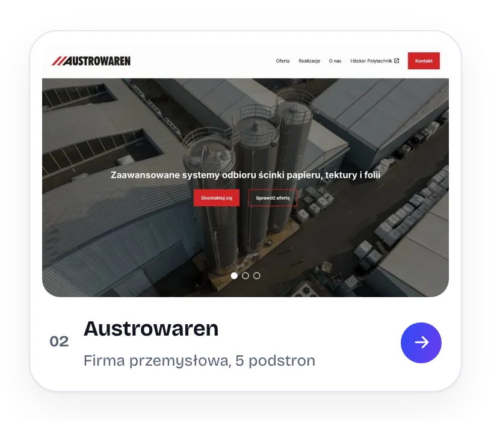</picture></a>
<a href="https://mateusz-dams.github.io/cwiczenia/silvermedica.html"><picture><source media="(prefers-color-scheme: dark)" srcset="img/cwiczenie-silvermedica-ciemny.webp">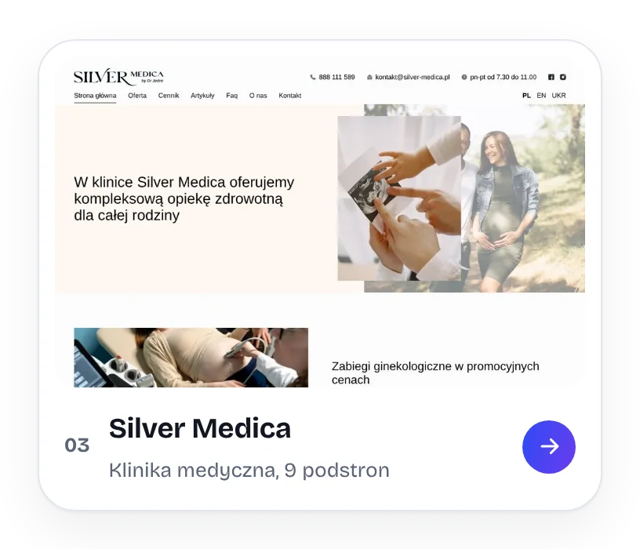</picture></a>

<a href="https://mateusz-dams.github.io/cwiczenia/azs.html"><picture><source media="(prefers-color-scheme: dark)" srcset="img/cwiczenie-azs-ciemny.webp">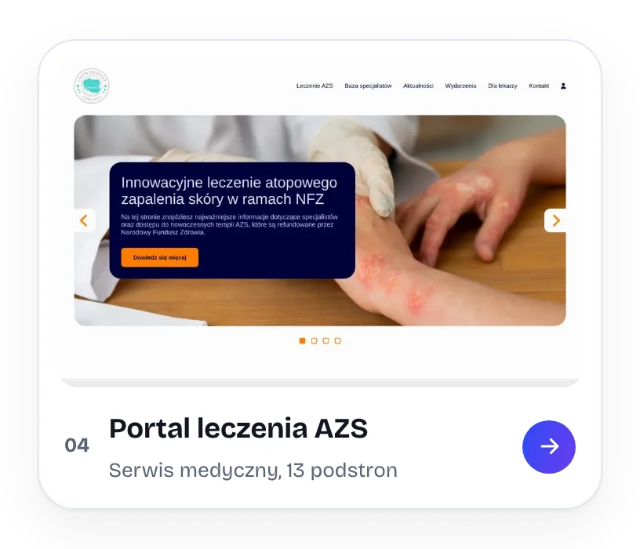</picture></a>
<a href="https://mateusz-dams.github.io/cwiczenia/leadtrust.html"><picture><source media="(prefers-color-scheme: dark)" srcset="img/cwiczenie-leadtrust-ciemny.webp">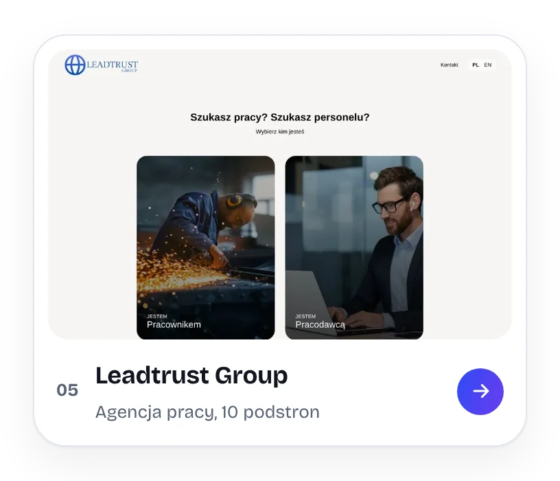</picture></a>
<a href="https://mateusz-dams.github.io/cwiczenia/staxx.html"><picture><source media="(prefers-color-scheme: dark)" srcset="img/cwiczenie-staxx-ciemny.webp">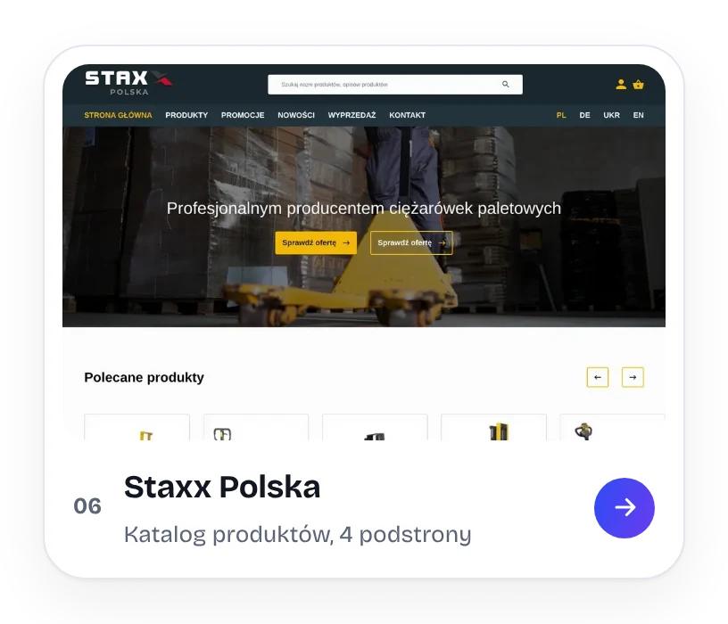</picture></a>

Każde ćwiczenie ma w portfolio podstronę z podglądem na żywo: stronę można przełączyć na widok komputera, tabletu i telefonu oraz otworzyć dowolną z zakodowanych podstron. Kod ćwiczeń: [Topblind](https://github.com/mateusz-dams/mateusz-dams.github.io/tree/main/topblind) · [Austrowaren](https://github.com/mateusz-dams/mateusz-dams.github.io/tree/main/austrowaren) · [Silver Medica](https://github.com/mateusz-dams/mateusz-dams.github.io/tree/main/silvermedica) · [Portal leczenia AZS](https://github.com/mateusz-dams/mateusz-dams.github.io/tree/main/azs) · [Leadtrust Group](https://github.com/mateusz-dams/mateusz-dams.github.io/tree/main/leadtrust) · [Staxx Polska](https://github.com/mateusz-dams/mateusz-dams.github.io/tree/main/staxx). Elementy spoza zakresu ćwiczenia (wysyłka formularzy, wyszukiwanie, przełącznik języka) pokazują komunikat zamiast prowadzić donikąd.

 

<a href="https://mateusz-dams.github.io/">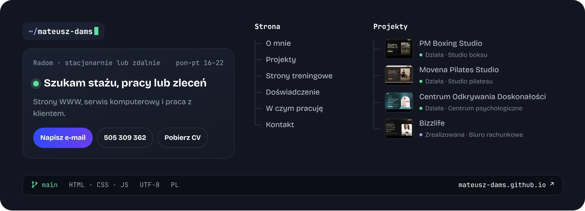</a>

<a href="https://mateusz-dams.github.io/">Portfolio</a> · <a href="https://mateusz-dams.github.io/cv/CV-Mateusz-Dams.pdf">CV (PDF)</a> · <a href="mailto:dams.mateusz@gmail.com">dams.mateusz@gmail.com</a> · tel. 505 309 362

 

Autor: Mateusz Dams. Fragmenty kodu motywów WordPress są pokazane wyłącznie do wglądu. Prawa do motywów, treści i zdjęć należą do firm, dla których powstały (zobacz [LICENSE](https://github.com/mateusz-dams/mateusz-dams.github.io/blob/main/LICENSE)). Projekty graficzne ćwiczeń: agencja Ajmer.
